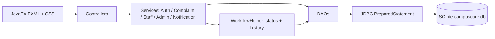

# CampusCare Architecture

## Module -> files
| Module | Main files |
|---|---|
| M1 Auth & Security | AuthService, UserDao, PasswordUtil, ValidationUtil, SessionManager, Login/Register/Profile controllers |
| M2 Complaint Reporting | ComplaintService.submit, SubmitComplaint, MyComplaints, ComplaintDetails |
| M3 Tracking & History | HistoryDao, ComplaintTable (search/filter/sort), timeline in ComplaintDetailsController |
| M4 Staff Resolution | StaffService, StaffComplaintController |
| M5 Notification | NotificationService, NotificationDao, NotificationsController |
| M6 Analytics/Feedback/Reports | AnalyticsDao, AnalyticsController, FeedbackController, CsvUtil |
| M7 Admin Management | AdminService, User/Department/Category/Location/AdminComplaints controllers |
